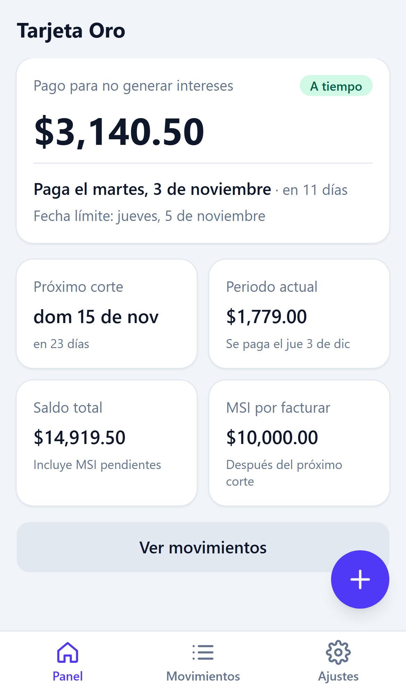
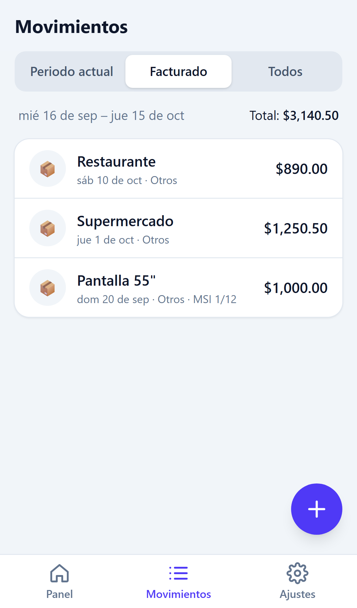
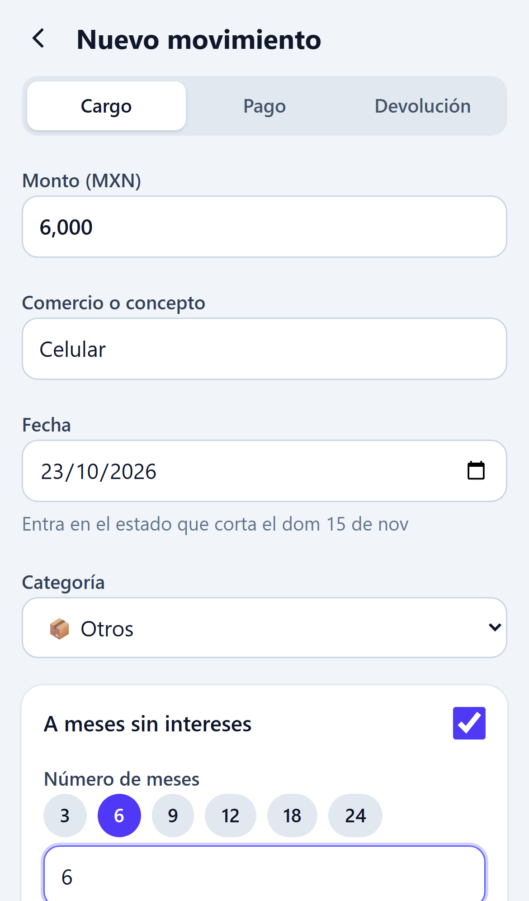
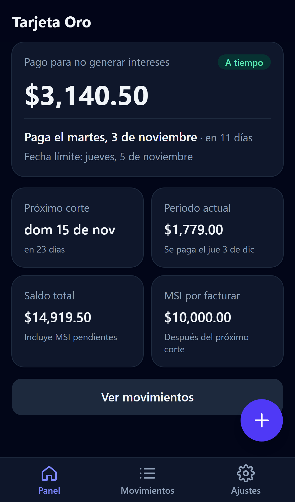

# GastosApp

[](https://github.com/Hugoch77/GastosApp/actions/workflows/ci.yml)

App web progresiva (PWA), pensada para el celular, para llevar los gastos de tarjetas de crédito en México
y saber en todo momento:

- **cuándo es el próximo corte**,
- **cuál es la fecha límite de pago**, y
- **cuánto pagar para no generar intereses**.

**Pruébala:** <https://hugoch77.github.io/GastosApp/>. Se puede instalar en la pantalla de inicio y funciona sin conexión.
Tus datos se guardan solo en tu dispositivo.

<p align="center">
  
  
  
  
</p>

## Funcionalidades

- **Panel**: pago para no generar intereses, fecha sugerida de pago con semáforo (_A tiempo_, _Paga pronto_, _Paga ya_, _Vencido_),
  próximo corte, gasto del periodo actual, saldo total y MSI por facturar.
- **Movimientos** agrupados en _Periodo actual_, _Facturado_ y _Todos_: cargos, pagos y devoluciones.
- **Meses sin intereses**: reparto exacto de las mensualidades por estado de cuenta, con vista previa al capturar.
- **Varias tarjetas**, cada una con su día de corte, día límite de pago y días de anticipación para pagar.
- **Días inhábiles bancarios** de México calculados automáticamente (incluida la Semana Santa), más días
  adicionales configurables.
- **Respaldo**: exportar e importar todos los datos en JSON.
- **PWA**: instalable, funciona sin conexión, tiene modo oscuro y avisa cuando hay una versión nueva.

## Cómo calcula las fechas

| Concepto                       | Regla                                                                                                              |
| ------------------------------ | ------------------------------------------------------------------------------------------------------------------ |
| Periodo                        | Del día siguiente al corte anterior hasta el día de corte, inclusive.                                              |
| Día de corte que no existe     | Se usa el último día del mes (31 → 28/29 en febrero, 30 en abril).                                                 |
| Fecha límite                   | El primer día de pago posterior al corte, aunque caiga en el mes o el año siguiente.                               |
| Fecha límite en día inhábil    | Se muestra la fecha nominal; el siguiente día hábil aparece solo como nota.                                        |
| Fecha sugerida de pago         | Fecha límite menos los días de anticipación (2 por defecto); si cae en día inhábil, se adelanta al hábil anterior. |
| Pago para no generar intereses | Cargos y mensualidades MSI del estado facturado, menos devoluciones, menos pagos hechos después del corte.         |

Todos los montos se manejan en centavos enteros para evitar errores de redondeo, y "hoy" se calcula en la zona
horaria de la Ciudad de México.

## Tecnologías

- [React](https://react.dev/) + [TypeScript](https://www.typescriptlang.org/) (modo estricto) con [Vite](https://vite.dev/)
- [Tailwind CSS](https://tailwindcss.com/) para los estilos
- [React Router](https://reactrouter.com/) para la navegación
- [Zod](https://zod.dev/) para validar los datos guardados e importados
- [vite-plugin-pwa](https://vite-pwa-org.netlify.app/) para el service worker y el manifest
- [Vitest](https://vitest.dev/) + [fast-check](https://fast-check.dev/) para pruebas unitarias y de propiedades
- [pytest](https://pytest.org/) + [Playwright](https://playwright.dev/python/) para pruebas E2E con Page Objects
- [oxlint](https://oxc.rs/) + [Prettier](https://prettier.io/) para lint y formato
- GitHub Actions para integración continua y publicación en GitHub Pages

## Estructura

```
src/
  domain/      Lógica de negocio pura: fechas, cortes, días inhábiles, MSI, dinero y cálculos del panel
  data/        Esquemas, repositorio en LocalStorage, migraciones y respaldos
  lib/         Fecha actual (zona CDMX), formatos y descargas
  state/       Contexto de React con los datos cargados
  hooks/       Hooks reutilizables
  components/  Componentes de interfaz
  pages/       Pantallas
e2e/           Pruebas E2E (pytest + Playwright)
tools/         Scripts de apoyo (generación de íconos)
```

La lógica de negocio (`src/domain`) no depende de React ni del almacenamiento, y nunca lee el reloj del sistema:
la fecha de hoy se recibe como parámetro. Así cada regla se puede probar con fechas fijas.

## Desarrollo local

Requisitos: Node.js 24 y, para las pruebas E2E, Python 3.13.

```bash
npm install
npm run dev          # http://localhost:5173
```

| Comando              | Descripción                                       |
| -------------------- | ------------------------------------------------- |
| `npm run build`      | Build de producción en `dist/`                    |
| `npm run preview`    | Sirve el build en http://localhost:4173           |
| `npm test`           | Pruebas unitarias                                 |
| `npm run test:watch` | Pruebas unitarias en modo watch                   |
| `npm run lint`       | Lint                                              |
| `npm run typecheck`  | Verificación de tipos                             |
| `npm run format`     | Formatea el código (`format:check` solo verifica) |

### Pruebas E2E

```bash
python -m venv .venv
.venv/Scripts/python -m pip install -r e2e/requirements.txt   # en Linux/macOS: .venv/bin/python
.venv/Scripts/python -m playwright install chromium

npm run build && npm run preview   # en otra terminal
.venv/Scripts/python -m pytest e2e
```

Las pruebas simulan un celular, usan la zona horaria de la Ciudad de México y fijan la fecha del navegador para
que los resultados no dependan del día en que se ejecutan.

## Integración continua y publicación

Cada push ejecuta el workflow [`ci.yml`](.github/workflows/ci.yml):

1. **Checks**: lint, formato, tipos, pruebas unitarias y build.
2. **E2E**: pruebas con Playwright sobre el build de producción.
3. **Deploy** (solo en `master`): si todo pasa, publica el build en GitHub Pages.

## Datos y privacidad

La información se guarda en el `localStorage` del navegador y no se envía a ningún servidor. Para cambiar de
dispositivo o tener un respaldo, usa **Ajustes → Descargar respaldo** y luego importa el archivo JSON.
Borrar los datos del sitio en el navegador borra también los movimientos, así que conviene exportar un respaldo
de vez en cuando.
